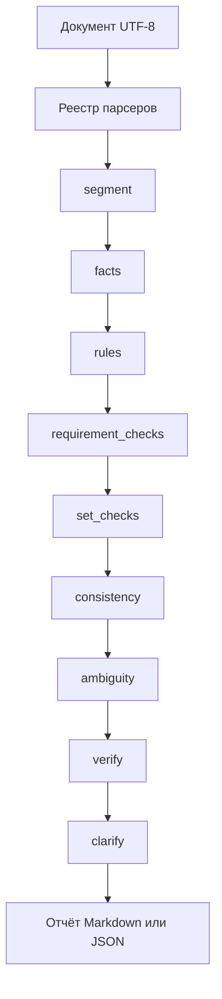

# Архитектура



`cli` связывает ввод, провайдер, конвейер и запись результатов. `review` зависит от `doc` и `llm`. У этих двух крейтов нет зависимостей от остальных крейтов workspace.

`doc` сохраняет блоки в порядке исходного текста. Идентификаторы начинаются с единицы и стабильны при повторном разборе того же документа. Номера строк начинаются с единицы, конец диапазона включён. Парсеры PDF и DOCX зарегистрированы и возвращают типизированную ошибку формата.

`RunContext` хранит документ, исходный текст для сверки цитат, промежуточные результаты и трассу стадий. `CheckRegistry` подключает проверки к `rules`, `requirement_checks` и `set_checks`. Промпты хранятся в `prompts/` и компилируются через `include_str!`.

`llm` строит JSON Schema из целевого Rust-типа и десериализует ответ. CLI оборачивает провайдер в таком порядке, от внешнего слоя к внутреннему.

```text
TracingProvider → CachedProvider → RetryProvider → RateLimitedProvider → MockProvider
```

Кэш исключает сетевую попытку при попадании. Повторы на 429 и 5xx тоже проходят через ограничитель. В трассе попадание в кэш отражается нулевым расходом токенов.

`verify` сверяет каждую цитату с исходным текстом в указанном диапазоне строк. `Report` рассчитывает сводку и статус готовности по данным прогона. Каркас выводит статус незавершённых проверок.
