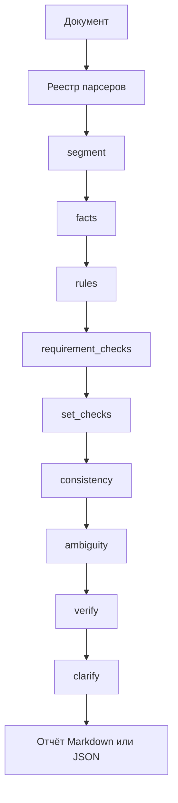

# Архитектура



`cli` связывает ввод, провайдер, конвейер и запись результатов. `review` зависит от `doc` и `llm`. Mock-провайдер использует тип блока из `doc`.

`doc` сохраняет блоки в порядке исходного текста. Идентификаторы начинаются с единицы и стабильны при повторном разборе того же документа. Номера строк начинаются с единицы, конец диапазона включён. Парсеры PDF и DOCX зарегистрированы и возвращают типизированную ошибку формата.

`RunContext` хранит разобранный документ, промежуточные результаты и трассу стадий. `CheckRegistry` подключает детерминированные проверки к `rules`, `requirement_checks` и `set_checks`. Промпты хранятся в `prompts/` и компилируются через `include_str!`.

`llm` строит JSON Schema из целевого Rust-типа и десериализует ответ. CLI оборачивает провайдер в таком порядке, от внешнего слоя к внутреннему.

```text
TracingProvider → CachedProvider → RetryProvider → RateLimitedProvider → GeminiProvider
```

Кэш проверяет ответ по JSON Schema при чтении и перед записью. Повторы на 429 и 5xx проходят через ограничитель. В трассе попадание в кэш отражается нулевым расходом токенов.

`verify` сверяет цитаты с текстом разобранных блоков по строкам и странице, нормализуя пробелы и кавычки. Подтверждённый дефект высокой или критической важности блокирует готовность. Неподтверждённый дефект такой важности, пустая нарезка или неполный прогон требуют завершить проверку.
