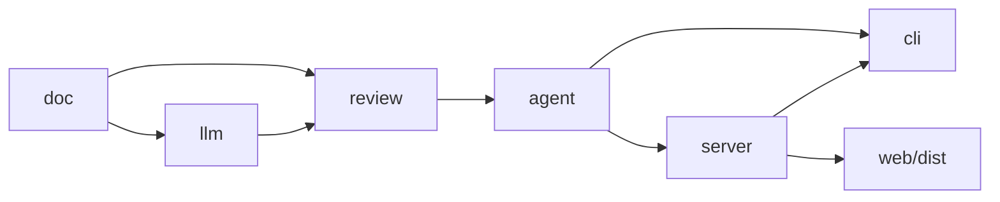
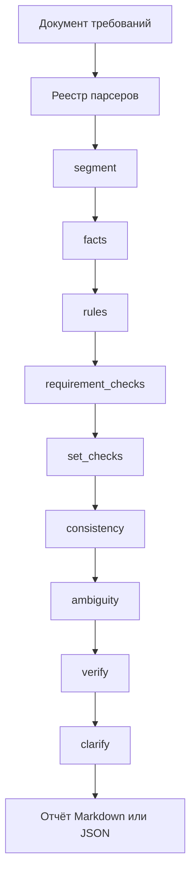

# Архитектура





Бинарь `rs` из крейта `cli` подключает терминал и файловые команды. `agent` связывает провайдер, конвейер и отчёт и содержит общее ядро сессии для CLI и HTTP. `server` хранит сессии, передаёт их события через SSE и раздаёт `web/dist`. `review` зависит от `doc` и `llm`. Mock-провайдер использует тип блока из `doc`.

`doc` сохраняет блоки в порядке исходного текста. Идентификаторы начинаются с единицы и стабильны при повторном разборе того же документа. Номера строк начинаются с единицы, конец диапазона включён. Парсеры PDF и DOCX зарегистрированы и возвращают типизированную ошибку формата.

`RunContext` хранит разобранный документ, промежуточные результаты и трассу стадий. `CheckRegistry` подключает детерминированные проверки к `rules`, `requirement_checks` и `set_checks`. Стадии `rules` и `verify` выполняются кодом без вызова модели. Промпты остальных стадий хранятся в `prompts/` и компилируются через `include_str!`.

`llm` строит JSON Schema из целевого Rust-типа и десериализует ответ. `agent` оборачивает провайдер в таком порядке, от внешнего слоя к внутреннему.

```text
CachedProvider → RetryProvider → RateLimitedProvider → GeminiProvider | OpenAiProvider
```

`OpenAiProvider` работает с любым API, совместимым с OpenAI Chat Completions. Такие сервисы принимают только схему-объект, поэтому схема стадии кладётся в поле `result` обёртки, определения `$defs` поднимаются в её корень, а ответ разворачивается обратно до проверки схемы. Для OpenRouter `llm` дополнительно читает каталог моделей и лимиты ключа.

Слой повторов проверяет свежие ответы по JSON Schema, а кэш проверяет прочитанные записи. Некорректный JSON или нарушение схемы допускают один повтор. Сетевые ошибки и HTTP 5xx повторяются до четырёх раз с паузами 5, 15, 30 и 60 секунд, а HTTP 429 учитывает задержку сервера. Повторы проходят через ограничитель. Трасса содержит отдельную запись на каждую попытку с расходом токенов, если провайдер его сообщил. Попадание в кэш помечается `cached: true` и нулевым расходом.

`verify` сверяет цитаты с текстом разобранных блоков по строкам и странице, нормализуя пробелы и кавычки. `clarify` вызывает модель только при наличии подтверждённых замечаний. Подтверждённый дефект высокой или критической важности блокирует готовность. Неподтверждённый дефект такой важности, пустая нарезка или неполный прогон требуют завершить проверку.
