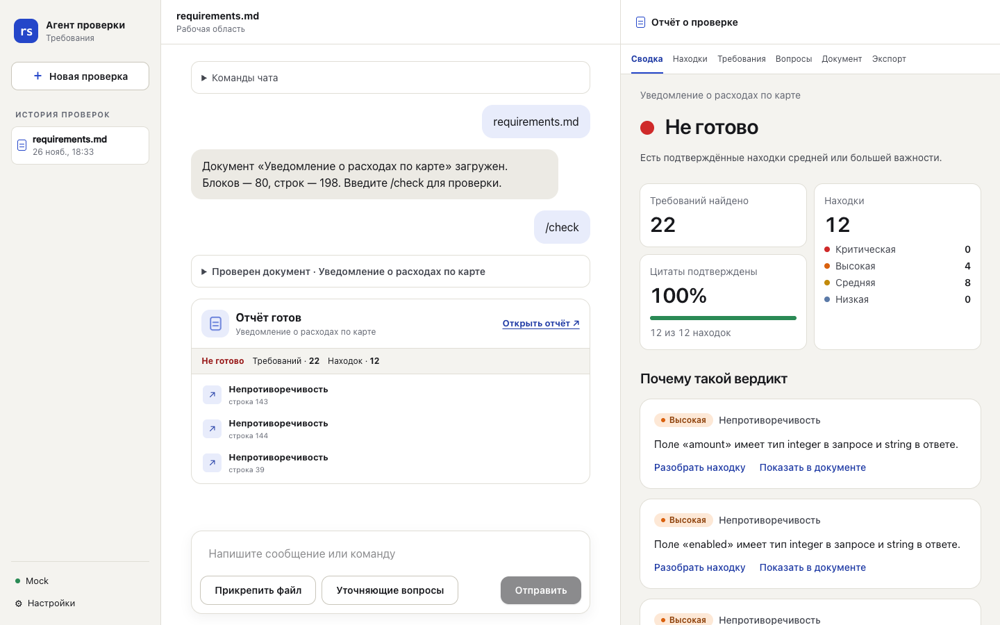
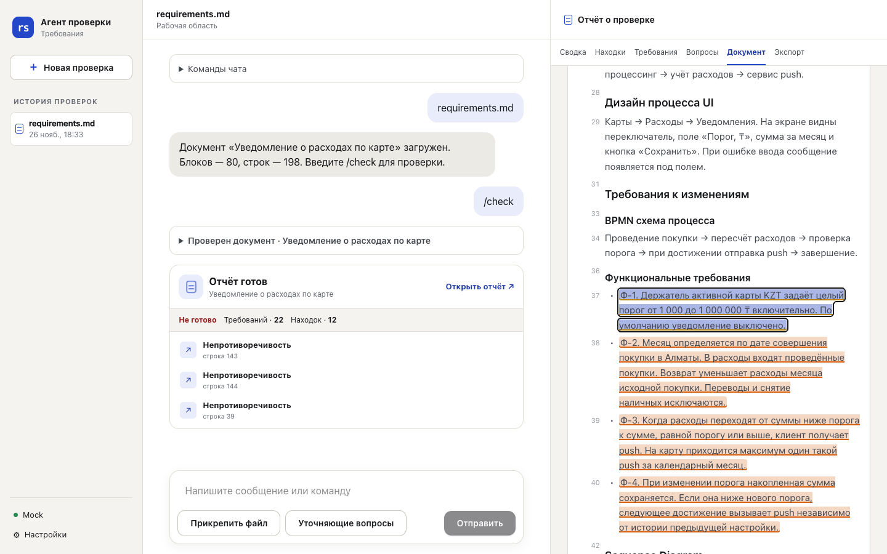
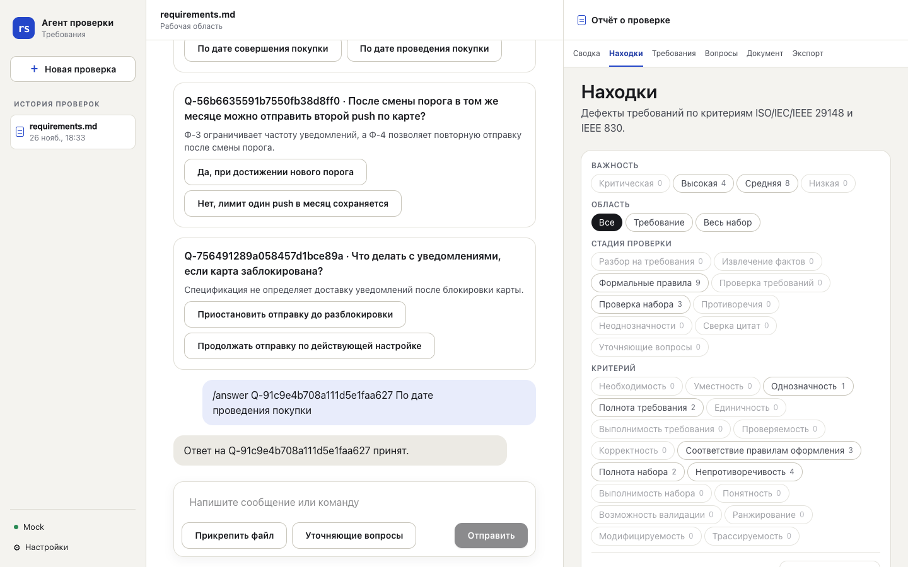

# Агент проверки требований

Находит дефекты в документе требований, задаёт уточняющие вопросы и выносит вердикт: можно ли передавать документ в разработку.

ISO/IEC/IEEE 29148 · IEEE 830 · Rust CLI и веб-чат

BCC-HUB x MNU

---

# Проблема и ценность для банка

- Дефект, найденный на ревью требований, исправить дешевле, чем найденный в тестировании или после релиза: переделывают и код, и тесты, и интеграции.
- Аналитик читает десятки страниц, а противоречия прячутся между разделами: Ф-3 запрещает второй push в месяц, Ф-4 разрешает его после смены порога.
- Ревью требований делается вручную и по-разному у разных людей.

**Что даёт агент**

- Проверка по критериям стандартов за минуты, с указанием строки документа.
- Вопросы автору только там, где без ответа нельзя реализовать или протестировать.
- Единый вердикт «Не готово / Готовность не подтверждена / Готово» с причинами.

---

# Конвейер: десять стадий

```text
triage → segment → facts → rules → requirement_checks → set_checks
       → consistency → ambiguity → verify → clarify
```

| Стадии с моделью | Стадии кода |
| --- | --- |
| `triage`, `segment`, `facts`, `requirement_checks`, `set_checks`, `ambiguity`, `clarify` | `rules`, `consistency`, `verify` |

- Документ разбирается в блоки с номерами строк и страниц (Markdown, TXT, PDF, DOCX).
- Каждая стадия модели возвращает строго типизированный JSON, схема строится из Rust-типа.
- Повторы, лимит запросов и кэш ответов — слои вокруг провайдера, одинаковые для Gemini и OpenAI-совместимых API.

---

# Проверку цитат и вердикт считает код

**Модель предлагает, код решает.**

- Каждая находка несёт дословную цитату со страницей и строками. Стадия `verify` сверяет цитату с текстом документа. Не нашлась — `verified: false`.
- Вердикт вычисляет код по правилам (`docs/decisions.md`, решение 005):
  - «Не готово» — есть подтверждённая находка средней важности или выше;
  - «Готовность не подтверждена» — проверки неполные или есть неподтверждённые серьёзные находки;
  - «Готово» — иначе, только на реальном провайдере.
- Часть дефектов ловят правила без LLM: пустой раздел тестирования, не заполненные версия и дата, размытые слова, расхождение типов поля в запросе и ответе.

---

# Метрики на эталонной разметке

Замер `gemini-3.1-flash-lite`, 26.11.2026, `eval/README.md`. Эталон — заложенные дефекты в двух документах.

| Эталон | Найдено | Recall | Precision |
| --- | ---: | ---: | ---: |
| Уведомление о расходах по карте | 8/14 | 57,1 % | 33,3 % |
| Онлайн-заявка на кредит (независимый документ) | 12/13 | 92,3 % | 46,2 % |
| **Всего** | **20/27** | **74,1 %** | **40,0 %** |

Precision — нижняя оценка: находки вне эталона снижают её, даже если они реальные.

**Уточняющие вопросы:** эталон 12 + 6 вопросов, метрика покрытия добавлена в `rs eval`. Покрытие на реальной модели — <span class="todo">заполнить после прогона `rs eval --golden eval/`</span>.

---

# Пример находки со ссылкой на строку

Противоречие, строки 39 и 40 документа `samples/requirements.md`:

> **Ф-3.** …На карту приходится **максимум один такой push за календарный месяц**. (строка 39)
>
> **Ф-4.** …следующее достижение вызывает push **независимо от истории предыдущей настройки**. (строка 40)

- Критерий: непротиворечивость набора (29148 § 5.2.6), важность — высокая, цитаты подтверждены.
- Из отчёта `docs/api/fixtures/report.json` (прогон `--provider mock`). На реальной модели формулировки отличаются.
- Агент задаёт вопрос: «После смены порога в том же месяце можно отправить второй push по карте?» с вариантами ответа.

---

# Интерфейс

 

Слева вкладка «Сводка»: вердикт «Не готово» и причины. Справа «Документ»: подсвеченные места, клик открывает находку с цитатой и строкой. Ещё вкладки «Находки» (фильтры), «Требования», «Вопросы» и «Экспорт» (JSON, Markdown).

Скриншоты сняты в прогоне `rs serve --provider mock`.

---

# Уточнение: вопросы и перепроверка



- Вопрос возникает только по подтверждённой находке и несёт цитату из документа.
- 2–3 варианта ответа и пояснение «почему спрашиваем».
- Ответ в чате: `/answer <ID> <вариант>`, в терминале: `rs ask`.
- Ответы сохраняются, повторная проверка показывает их под связанными находками.
- Метрика покрытия вопросов эталоном: сколько обязательных вопросов задал агент, сколько пропустил, сколько вопросов без привязки к тексту.

---

# Ограничения и что дальше

**Ограничения**

- Находит 74,1 % заложенных дефектов, precision — нижняя оценка 40,0 %. Отчёт читает аналитик.
- Эталоны написаны командой, промпты настраивались на тех же документах.
- Нет OCR: сканы и картинки не читаются. DOCX покрыт тестами, на демо не показан.
- Предложения по исправлению даются в тексте находки, документ не правится.

**Что дальше (планы, не реализовано)**

- Замерить покрытие вопросов и расход токенов на реальной модели.
- Расширить эталоны и сравнить промпты на независимых документах.
- Интеграция с трекером задач и правка документа по принятым ответам.
